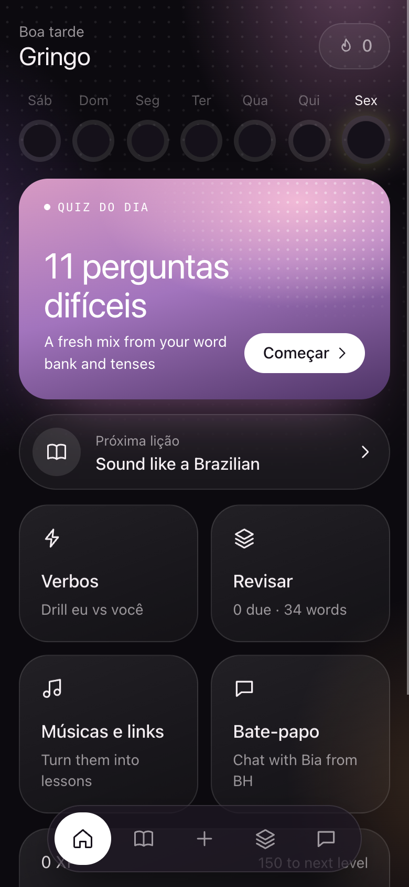
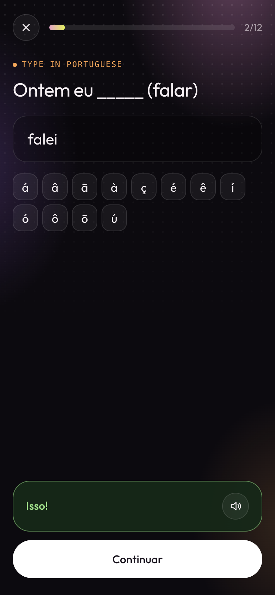
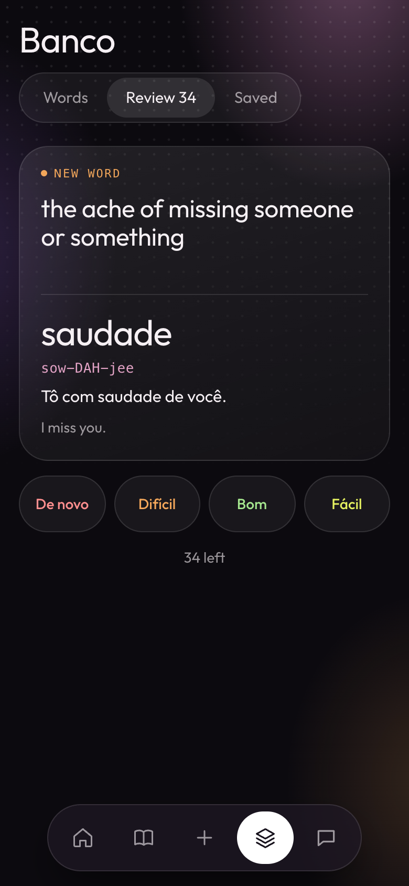
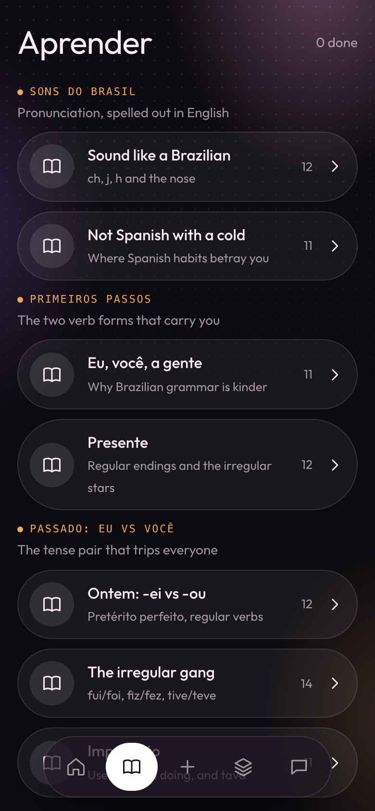
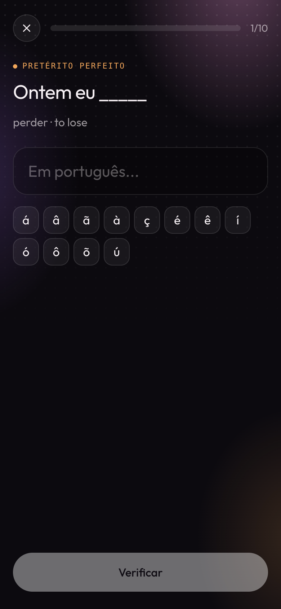
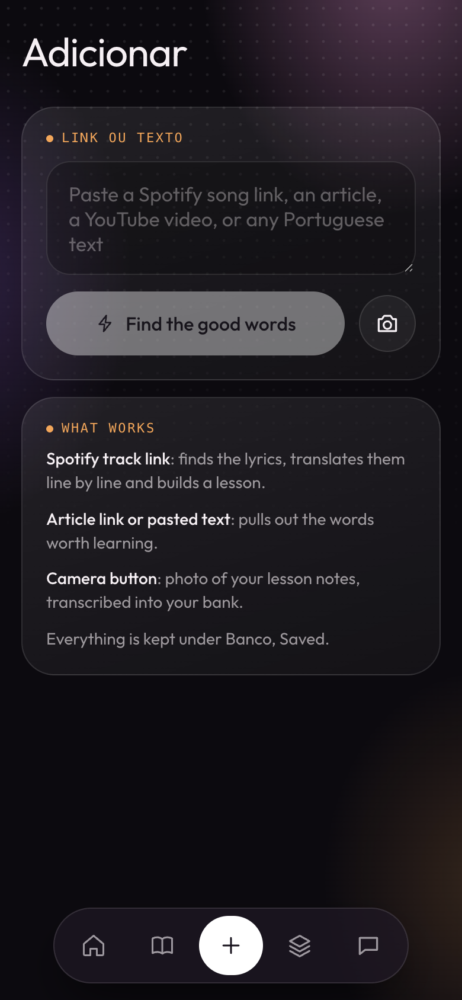

<h1 align="center">jeitinho</h1>

<p align="center">
Learn Brazilian Portuguese the mineiro way.<br>
A small, fast, gamified app that lives on your phone's home screen and runs on free AI models.
</p>

<p align="center">



</p>

*Jeitinho* is the Brazilian knack for finding a way. This app is my way to get from zero to fluent without paying for five subscriptions.

## What it does

- **Daily quiz of 11 hard questions.** Built fresh every day from your word bank and verb tenses. A time decay keeps questions you just saw out of the next quizzes, so it never feels like the same quiz twice.
- **Lessons that explain, then make you produce.** Pronunciation spelled out in English (`leite` = LAY-chee), eu vs você in every past tense, the three subjunctives, and where Spanish habits betray you.
- **Mineirês.** Two lessons on how people talk in Belo Horizonte: uai, trem, cê, tiquim, arreda, and why "Oncotô?" is a full sentence.
- **Verb drill.** Pick tenses, get ten quick questions with a time cue (Ontem, Se, Quando). The eu vs você mode asks both forms back to back.
- **Word bank with spaced repetition.** Works like Anki, and can export a file Anki imports.
- **Songs.** Paste a Spotify track link. It finds the lyrics, translates them line by line and builds a lesson from the song.
- **Links and text.** Paste an article or a YouTube link and it pulls out the words worth learning.
- **Photos of your lesson notes.** The camera button transcribes them and adds the vocabulary to your bank.
- **Bate-papo.** Chat with Bia, a mineira from BH, who answers in spoken Brazilian Portuguese and corrects your message each turn.
- **Lessons on demand.** Type any topic, pick a level from A1 to C2, get a lesson.

<p align="center">



</p>

## Why it is built this way

The design follows what learning research keeps finding (Dunlosky et al., 2013, is a good summary):

| Finding | In the app |
| --- | --- |
| Recalling beats rereading | Most questions make you type the Portuguese. Multiple choice is the minority. |
| Spacing beats cramming | Every word has its own review interval, and quiz questions decay before they can come back. |
| Mixing topics beats blocks | The daily quiz mixes vocabulary, listening and seven tenses. |
| Feedback should be instant | Each answer shows the right form, the full conjugation and an example, with audio. |
| You learn from content you care about | Your songs, your articles and your own class notes become the material. |
| Errors need a second try | Missed lesson questions come back before the lesson ends. |

## Run it

```bash
npm install
cp .env.example .env   # add your OpenRouter key
npm run dev
npm test               # conjugator, quiz spacing, answer checking, URL safety
```

Lessons, the quiz, the drill and the word bank work with no key at all. The key only powers importing, chat and custom lessons.

## Deploy your own

1. Get a free key at [openrouter.ai/keys](https://openrouter.ai/keys). Set its credit limit to $0.
2. Import this repo in Vercel and add `OPENROUTER_API_KEY` as an environment variable.
3. Optional: add `APP_PASSCODE` so strangers who find your URL cannot use up your free quota. Type the same passcode under Settings in the app.
4. On iPhone: open the site in Safari, tap Share, then **Add to Home Screen**.

### It cannot cost money

The server only ever calls models whose ID ends in `:free` (or the `openrouter/free` router). Anything else in `OPENROUTER_MODELS` is dropped in code, see `src/routes/api/ai/+server.js`. A $0 credit limit on the key is the second lock.

## How it is made

- **SvelteKit**, prerendered. The whole app is about 60 kB of gzipped JavaScript, so it opens fast on a phone.
- **No database, no accounts.** Progress lives in your browser's local storage. Settings has export and import for backups.
- **Voice** is the pt-BR voice built into your phone, so audio is free and instant.
- **Lyrics** come from [LRCLIB](https://lrclib.net).

```
src/lib/conj.js       verb conjugator (7 tenses, regular rules plus an irregular table)
src/lib/quiz.js       answer checking, spaced repetition, daily quiz selection
src/lib/content.js    the hand-written course and starter word bank
src/lib/Exercise.svelte   the question runner used by lessons, quiz and drill
src/routes/api/ai     the only server code: import, chat, lesson
```

## Honest limits

- The hand-written course is a strong start, not the full road to C2. The daily quiz, your own material, the chat and custom lessons carry you past it.
- Free models are rate limited and sometimes slow. Try again if one times out.
- YouTube often hides captions from servers. When that happens the app says so and you can paste the transcript.
- It does not listen to your pronunciation yet.
- Progress does not sync between devices.

## Contributing

Lessons live in plain JavaScript in `src/lib/content.js`. If you are a native speaker and something sounds off, especially the mineirês, please open an issue or a PR.
