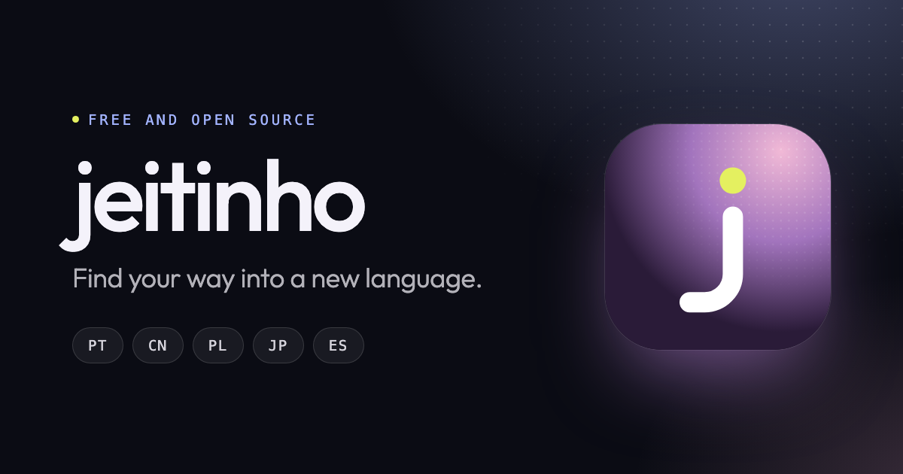
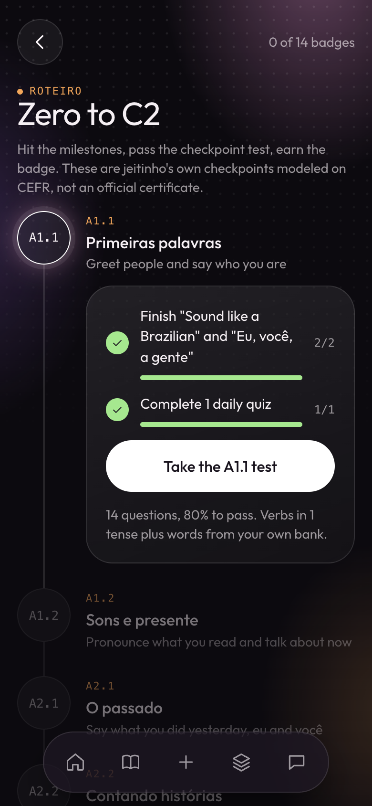
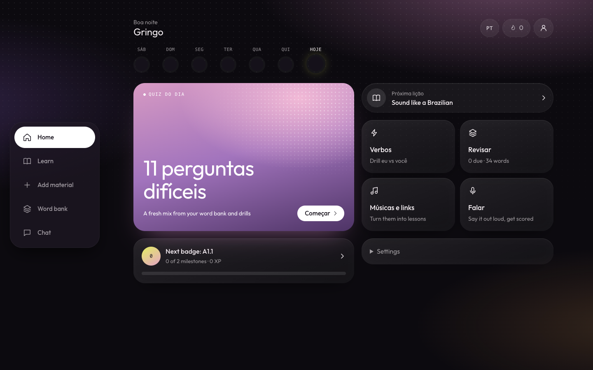
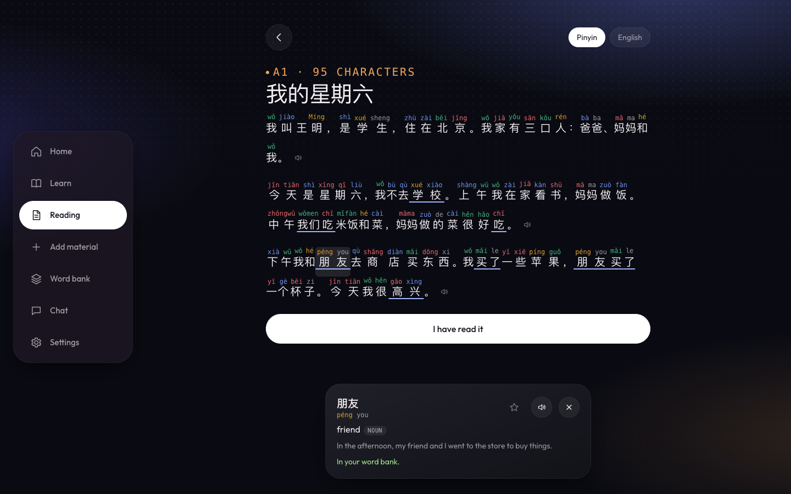

<p align="center"><a href="https://jeitinho-zeta.vercel.app"></a></p>

<h1 align="center">jeitinho</h1>

<p align="center"><b>Find your way into a new language.</b><br>A free, open source course from zero to fluent, on your phone or your desktop.<br>Brazilian Portuguese, Mandarin, Polish, Japanese and Spanish.</p>

<p align="center"><a href="https://jeitinho-zeta.vercel.app"><b>Open the app: jeitinho-zeta.vercel.app</b></a></p>

<p align="center">
<a href="https://github.com/KarinaKKarinaK/jeitinho/actions/workflows/ci.yml"></a>
<a href="LICENSE"></a>


</p>

<p align="center">
<a href="#features">Features</a> ·
<a href="#quick-start">Quick start</a> ·
<a href="#deploy">Deploy</a> ·
<a href="#cost">Cost</a> ·
<a href="#security-and-privacy">Security</a> ·
<a href="#contributing">Contributing</a>
</p>

No install and no account needed: open the link and start. Sign in only if you want your progress on more than one device.

<p align="center">



</p>

<p align="center"></p>

<p align="center"></p>

## Features

| | |
| --- | --- |
| **Daily quiz** | 11 hard questions from your word bank and drills. A time decay keeps recent questions out. |
| **Chapters** | Lessons are grouped into chapters. Finish a chapter, pass its quiz, and the next one opens. |
| **Reading** | Eight graded texts per language plus your own. Point at any word for its meaning and part of speech, click to save it. Meanings for the built-in texts are prepared ahead (`npm run gloss`), so reading them uses no AI. |
| **Grammar** | Every explanation from the course as a searchable reference, and a conjugation table for any verb (usage patterns for Mandarin). |
| **Made for Mandarin** | Pinyin above every word in reading texts, coloured by tone, with one tap to hide it. Tones can be typed as numbers (`ni3 hao3`). A listening drill for tone pairs, the HSK 1 to 3 word lists as ready-made collections, and a breakdown of what each character in a word means. |
| **Five languages** | Each has its own course of 20 or more lessons, drills, placement test and roadmap. Switch on the home screen; progress is kept separately per language under one account. |
| **Placement test** | New learners take a short test that climbs a level at a time and stops when it gets too hard. |
| **Drills** | The hard part of each language: verb tenses (Portuguese, Spanish), tones and measure words (Mandarin), cases and aspect (Polish), particles and verb forms (Japanese). |
| **Real speech** | Regional and spoken language, not only the textbook: mineirês from Belo Horizonte, the Beijing r, Kansai-ben, vosotros and vos. |
| **Word bank** | 175 to 215 starter words per language, tagged by part of speech. Stars, your own notes, collections, AI example sentences, spaced repetition and export to Anki. |
| **Songs** | Paste a Spotify link: lyrics with line by line translation, tap any word to see what it means and keep it, then a quiz built from the song. |
| **Import** | An article, a YouTube link, pasted text or a photo of your notes becomes flashcards. |
| **Speaking** | Say a sentence, see which words were understood. Voice mode in the chat. |
| **Chat** | Bia, a mineira from BH, replies in spoken Portuguese and corrects each message. |
| **Roadmap** | 14 checkpoints from A1.1 to C2.2. Milestones, then a test, then a badge. B and C tests add listening, speaking and graded writing. |
| **Accounts** | Google, GitHub or email. Progress syncs across devices. Profile with name and picture. Works signed out too. |
| **Offline** | Lessons, quiz, drill and word bank work with no connection. |
| **Settings** | Light and dark themes, seven voices, quiz length and content, daily goal, daily push reminders, and your own OpenRouter key for a stronger model. |
| **Progress** | Your level, a forecast date for the next one, and a map of minutes studied per day. |

## Quick start

```bash
npm install
cp .env.example .env
npm run dev
npm test
```

Lessons, quiz, drill and word bank need no keys.

## Deploy

1. Import the repo in [Vercel](https://vercel.com/new).
2. Add the environment variables you want from the table below.
3. On iPhone: open the site in Safari, Share, **Add to Home Screen**.

| Variable | Unlocks | Where to get it |
| --- | --- | --- |
| `OPENROUTER_API_KEY` | Import, chat, custom lessons, graded writing | [openrouter.ai/keys](https://openrouter.ai/keys), credit limit $0 |
| `ELEVENLABS_API_KEY` | Natural voice. Without it, the phone's voice is used. | [elevenlabs.io](https://elevenlabs.io), free plan |
| `DEEPGRAM_API_KEY` | Speaking practice, voice chat | [console.deepgram.com](https://console.deepgram.com), free credit |
| `SUPABASE_URL`, `SUPABASE_ANON_KEY` | Accounts, sync, saved photos | Vercel, Storage, add Supabase (free plan) |
| `APP_PASSCODE` | Locks AI and speech behind a passcode | You choose it |
| `VAPID_PUBLIC_KEY`, `VAPID_PRIVATE_KEY`, `CRON_SECRET`, `SUPABASE_SERVICE_ROLE_KEY` | Daily push reminders | Generate a P-256 key pair; see the note at the end of `supabase/schema.sql` |

### Accounts

1. Add Supabase from the Vercel Storage tab and redeploy.
2. Run [`supabase/schema.sql`](supabase/schema.sql) in the Supabase SQL editor.
3. In Supabase, Authentication, URL Configuration: set the Site URL to your URL and add `https://your-url/account` as a redirect.
4. For Google and GitHub, create an OAuth app with each and paste the client ID and secret under Authentication, Providers.

## Cost

It cannot bill you.

- The server only calls OpenRouter models whose ID ends in `:free`. Anything else is dropped in code (`src/routes/api/ai/+server.js`).
- ElevenLabs and Deepgram run on free plans with no card on file. When the quota ends the app falls back to the phone's voice, and speaking practice pauses.
- Each spoken phrase is cached for a year, so it uses quota once.

## Security and privacy

- No ads, no analytics, no tracking. The [privacy page](https://jeitinho-zeta.vercel.app/privacy) lists everything that is stored and where it goes.
- Every table has row level security: a signed-in user can read and write only their own rows and photos.
- API keys live on the server. A key you add yourself is encrypted on your device, never shown again, and never synced.
- Every endpoint that spends quota is rate limited per visitor, with a daily ceiling for everyone together.
- Imported links are fetched through a guard that refuses private addresses and oversized pages.
- A strict content security policy, and no secrets in the repository or its history.

Found a problem? Please [open an issue](https://github.com/KarinaKKarinaK/jeitinho/issues).

## Languages

| Language | Follows | Type answers in |
| --- | --- | --- |
| Brazilian Portuguese | CEFR, Celpe-Bras | Portuguese |
| Mandarin Chinese | HSK levels 1 to 6, 32 lessons | characters or pinyin |
| Polish | State certificate exams, A1 to C2 | Polish |
| Japanese | JLPT N5 to N1 | Japanese, kana or romaji |
| Spanish | Instituto Cervantes curriculum, DELE | Spanish |

A language is one file in `src/lib/langs/`. `src/lib/packs.test.js` is the contract it has to pass, so adding a language means writing one pack and registering it.

## How it works

- **SvelteKit**, prerendered, with a service worker. About 60 kB of JavaScript.
- **Local first.** State is one object per language in local storage, mirrored to one Postgres row per user and language when signed in. When two devices both changed, the copies are merged: progress only goes up, word banks are joined, deletions stay deleted.
- **Learning design** follows Dunlosky et al. (2013): recall over rereading, spaced review, mixed topics, instant feedback, and a second try on every miss.

```
src/lib/langs/            one pack per language: course, words, drills, placement, roadmap
src/lib/lang.js           loads the active language
src/lib/quiz.js           answer checking, spaced repetition, daily quiz
src/lib/roadmap.js        stages, milestones, checkpoint tests
src/lib/cloud.svelte.js   sign-in, sync, photos
src/lib/sync.js           when to push, pull or merge two copies
src/lib/Exercise.svelte   question runner
src/routes/api            ai, tts, stt, config, reminder
src/service-worker.js     offline cache
```

## Limits

- Speaking is scored by whether each word was understood, not sound by sound.
- Push reminders arrive on the hour you pick. On iPhone they need the app on the home screen.
- YouTube often hides captions from servers. Paste the transcript when that happens.
- Badges are this app's own checkpoints modeled on CEFR and each language's official exam levels, not a certificate.
- The courses were written with AI help and have not all been reviewed by native speakers. Report anything that sounds off.
- When two devices study at the same moment, sync keeps the higher XP rather than adding the two.

## Contributing

Lessons are plain JavaScript in `src/lib/langs/`. Corrections from native speakers are the most useful contribution: open an issue or a pull request. New languages are welcome too.

## License

[MIT](LICENSE)
